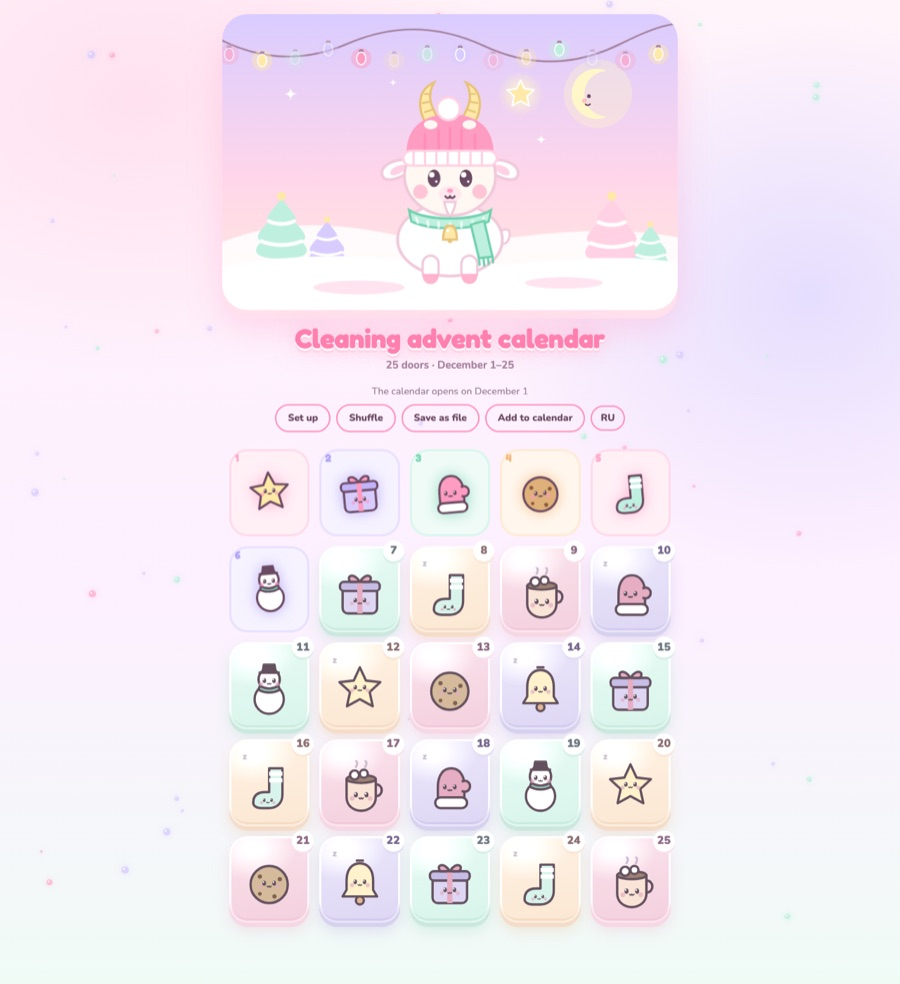
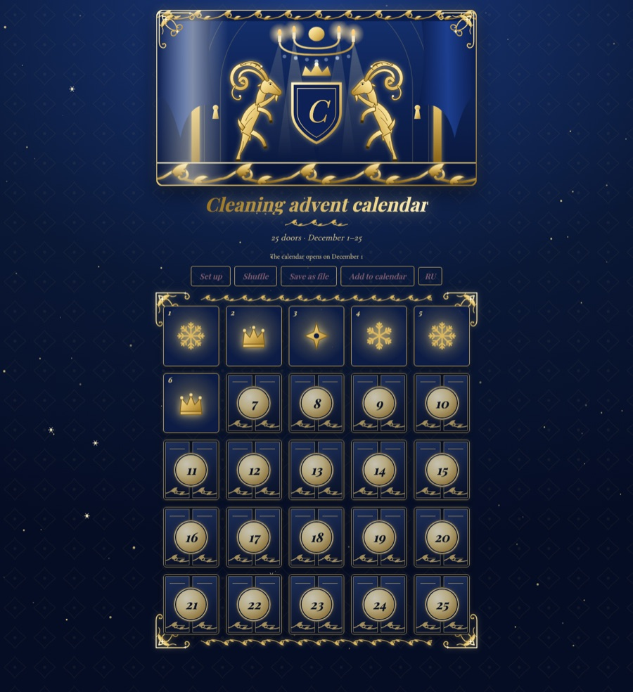
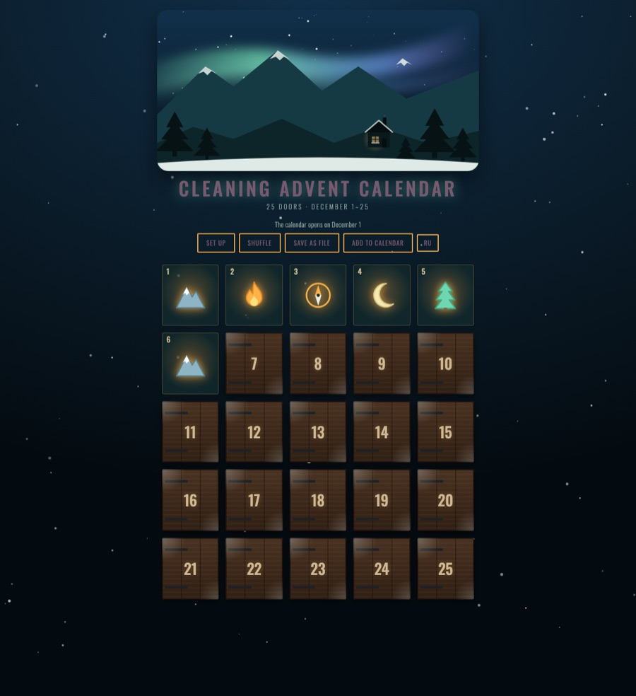
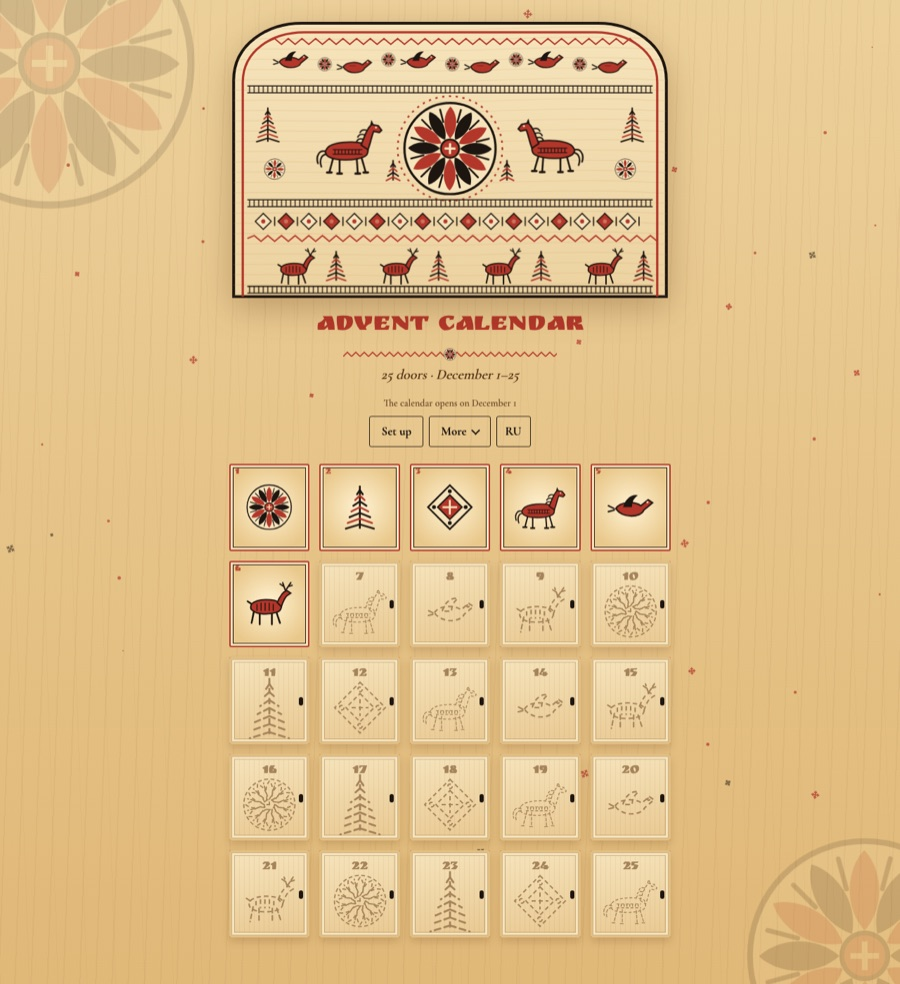
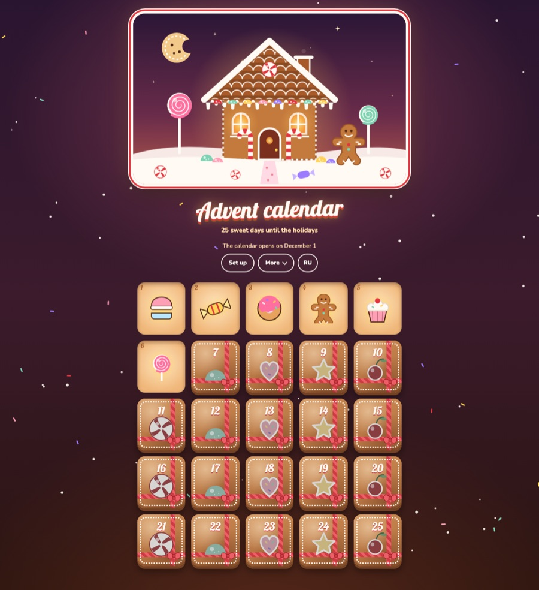

# Advent calendar maker

Turn any list into an advent calendar: one door a day, one task behind each door.
Cleaning, kind deeds, a book a day, small surprises for someone you love.

**Open it:** https://murpiter.github.io/advent-calendar/

No sign-up, no server, no tracking. The calendar lives in your browser and works offline.

<p>
  
  
  
  
  
</p>

## What it does

- **24, 25 or 31 doors.** Paste a list, one task per line, and the tasks are shuffled across the days.
- **Doors open on their day.** Today's door glows; future ones stay shut unless you allow opening any door.
- **Five styles**, each with its own art, fonts and animation: Kawaii, Palace, Northern forest, Mezen painting
  (Russian Northern folk art) and Gingerbread house.
- **A calendar as a gift.** The whole calendar packs into a link and a QR code you can print on a card.
  The recipient sees an envelope, and the tasks stay hidden until each door opens.
- **Phone calendar.** An `.ics` file adds every door as an all-day event; the tasks can stay a surprise.
- **Save as one file.** A single HTML file that opens with a double click, no internet needed.
- **Install it.** It is a PWA: add it to the Home Screen and it opens like an app, offline.
- **Russian and English.**

## Privacy and security

Nothing leaves the device. There are no accounts, analytics, cookies or third-party requests;
fonts and icons ship with the app.

- A gift link carries the calendar itself, compressed into the URL fragment, so it never reaches a server.
  It is compressed, not encrypted: anyone with the link can read the tasks.
- Every input is treated as hostile: gift links, saved files and stored data are validated
  (size limits, a guard against decompression bombs, only known fields, visible text only) before use,
  and user text is only ever written as text, never as HTML.
- A strict Content Security Policy with hashes: no inline handlers, no `eval`, no outside origins.
- Downloaded file names drop right-to-left override marks, so a name cannot disguise its real extension.

Two limits of the platform worth knowing:

- All GitHub Pages sites of one account share the origin `murpiter.github.io`, and with it `localStorage`.
- A saved HTML file opened from disk shares browser storage with other local files.

## Run it locally

Needs Node.js 22 or newer.

```bash
npm ci
npm test
npm run build
```

The build writes `dist/`: one `index.html` with inlined JS and CSS, plus fonts, icons, manifests and
the service worker. Serve that folder with any static server.

App icons are drawn in `art/icons/*.svg`; `npm run icons` renders them to PNG with resvg,
on any OS, no browser needed.

Every push to `main` runs the tests and publishes `dist/` to GitHub Pages.

## How it is built

Vanilla JavaScript modules, no framework. One runtime dependency, `qrcode-generator` for the QR code.
The build uses `esbuild` and takes the fonts from Fontsource packages.

```
src/
  domain/    calendar rules, gift links, .ics, validation: pure functions, covered by tests
  themes/    one module per style: SVG art, door pictures, falling particles
  styles/    base styles and one stylesheet per style
  ui/        screens and widgets
  i18n/      Russian and English texts
  storage/   localStorage with a namespace per calendar
  export/    downloads and the single-file save
  sw.js      offline cache
```

A style is a small object (`hero`, `icon`, `door`, `snow`, `particle`), so adding a sixth one
means one JS module and one stylesheet.

## License

Public domain ([Unlicense](LICENSE)): anyone can do anything with the code, the art and the texts.

Fonts come from [Fontsource](https://fontsource.org) packages under the SIL Open Font License;
the build copies them and their license texts into `dist/fonts/`.
